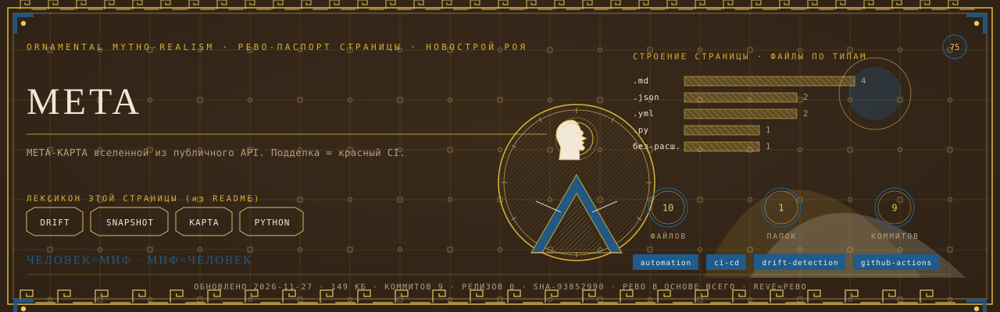

<div align="center">

<a href="https://github.com/rtynbirf/meta"></a>

</div>

<!--ФОРЖ:ПАСПОРТ:НАЧАЛО-->
<div align="center">
  
</div>

| ФАЙЛОВ | ПАПОК | КОММИТОВ | ОБНОВЛЕНО | РЕЛИЗОВ |
|---:|---:|---:|---|---:|
| 19 | 2 | 20 | 2026-11-28 | 0 |
<!--ФОРЖ:ПАСПОРТ:КОНЕЦ-->

# meta · МЕТА-КАРТА вселенной rtynbirf

> 1 смысл = 1 репо: карта публичного слоя дома, которую считает машина и
> стережёт CI. Репо рождено из `meta-layer-kit` (bootstrap-путь кита) —
> первый боевой деплой комплекта мета-управления.

## Заявление — артефакт — верификатор (E-GATE)

| Элемент | Факт |
|---|---|
| Заявление | Карта собрана инструментами кита из публичного API и стоит под drift-гейтом |
| Артефакт | `MAP.md` + `map.json` — сборка 2026-11-25T20:27:04+00:00: 83 публичных репо, 7 языков, 83 пуша за 30 дней |
| Верификатор | CI `meta-drift`: расхождение карты с живым API = красный; бот `meta-map` пересобирает карту на push и в 04:00 UTC |
| Статус зрелости | первый деплой кита в бою: **проверено** (drift=0 на сборке; дрейф дома 80→83 репо пойман китом до рождения репо) |

## Файлы

| Файл | Что это |
|---|---|
| `MAP.md` | карта: итоговые счётчики (маркеры `<!--c:…-->`) + таблица всех публичных репо |
| `map.json` | та же карта машинным языком |
| `api-capture.json` | офлайн-захват живого API для реплея без сети |
| `meta_snapshot.py` | генератор: `snapshot` / `drift` / `status`, только stdlib |
| `.github/workflows/meta-drift.yml` | CI-страж: карта обязана совпадать с живым API |
| `.github/workflows/meta-map.yml` | бот: пересборка карты на main и ночью |

## Правило №1: руками счётчик — ЗАПРЕЩЁН

Числа живут только маркерами `<!--c:имя-->N<!--/c-->`. Вписывает их `snapshot`,
проверяет `drift` (расхождение = exit 1 = красный CI).

## Команды

```bash
python3 meta_snapshot.py snapshot --login rtynbirf --root .
python3 meta_snapshot.py drift    --login rtynbirf --root .
python3 meta_snapshot.py status   --root .
```

Правила работы в этом репо — `AGENTS.md` (мембрана дома); уязвимости — `SECURITY.md`; лицензия — `LICENSE`.
